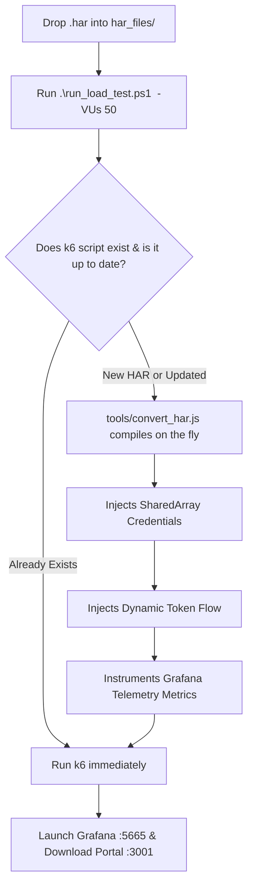

# ⚡ Complete k6 Enterprise Load Testing Master Guide (All-in-One)

> **Universal 1-Click Load Testing Framework for Web Applications & APIs**  
> *Everything you need in a single document: Recording HARs, 1-command execution, multi-account credentials, JMeter-to-k6 mapping, and real-time Grafana telemetry.*

---

## 📑 Table of Contents
1. [Quick Start: The 1-Command Flow](#1-quick-start-the-1-command-flow)
2. [Workspace Folder Structure](#2-workspace-folder-structure)
3. [How to Record Clean HAR Files (Chrome & Edge)](#3-how-to-record-clean-har-files-chrome--edge)
4. [Universal 1-Click Runner: Commands & Examples](#4-universal-1-click-runner-commands--examples)
5. [How Real Account Credentials Work (1-to-1 VU Mapping)](#5-how-real-account-credentials-work-1-to-1-vu-mapping)
6. [Auto-Conversion: Do We Need to Write New Scripts?](#6-auto-conversion-do-we-need-to-write-new-scripts)
7. [JMeter vs. k6 Concept Cheat Sheet](#7-jmeter-vs-k6-concept-cheat-sheet)
8. [Live Grafana Dashboard & Telemetry Download Portal](#8-live-grafana-dashboard--telemetry-download-portal)
9. [Scaling: From 1 User to 50,000+ Users](#9-scaling-from-1-user-to-50000-users)
10. [Production Safety Best Practices & FAQ](#10-production-safety-best-practices--faq)

---

## 1. Quick Start: The 1-Command Flow

Whenever you need to run a performance test:
```powershell
# Run ANY HAR recording with 50 Virtual Users:
.\run_load_test.ps1 prepespro2 -VUs 50
```

That's it! The runner will:
1. Detect `har_files/prepespro2.christuniversity.in.har`.
2. Automatically generate the k6 test script if it doesn't exist.
3. Authenticate 50 individual accounts from [prepespro_credentials.csv](file:///c:/Users/nithya.s/Documents/K6/tests/data/prepespro_credentials.csv).
4. Run the load test and chart every single API call.
5. Open the **Grafana Dashboard** (`:5665`) and **Download Portal** (`:3001`).

---

## 2. Workspace Folder Structure

All testing assets are organized into dedicated drop-zones:

```
c:\Users\nithya.s\Documents\K6\
│
├── 📂 har_files/                     <-- 🎯 DROP ALL .har BROWSER RECORDINGS HERE
│   ├── prepespro.christuniversity.in.har    <-- Old HAR (18 endpoints)
│   └── prepespro2.christuniversity.in.har   <-- New HAR (60 endpoints)
│
├── 📂 tests/
│   ├── 📂 data/                      <-- CSV test data & accounts
│   │   ├── prepespro_credentials.csv <-- 🔑 Paste your 50 real accounts here
│   │   └── students.csv
│   ├── 📂 christ_university/reports/ <-- Telemetry outputs & server
│   │   ├── grafana_report.html       <-- Offline Grafana HTML Dashboard
│   │   ├── grafana_api_metrics.csv   <-- Per-endpoint CSV report
│   │   ├── grafana_summary.json      <-- Raw machine-readable JSON metrics
│   │   └── report_server.js          <-- Telemetry & Download Portal server
│   ├── prepespro_har_load_test.js    <-- Script for Old HAR (18 endpoints)
│   └── prepespro2_har_load_test.js   <-- Script for New HAR (60 endpoints)
│
├── 📂 tools/                         <-- Automation tools
│   └── convert_har.js                <-- On-the-fly HAR converter (dynamic auth + Grafana)
│
├── 📜 run_load_test.ps1              <-- ⚡ 1-Click Universal PowerShell Test Runner
└── 📘 README.md                      <-- This Complete All-In-One Guide
```

---

## 3. How to Record Clean HAR Files (Chrome & Edge)

To record a clean user journey from any website:

1. Open **Google Chrome** or **Microsoft Edge**.
2. Press `F12` (or `Ctrl + Shift + I`) to open **Developer Tools**.
3. Click on the **Network** tab.
4. **Crucial Setup**:
   - Check **"Preserve log"** (ensures login redirects and multi-page flows are not lost).
   - Check **"Disable cache"** (simulates realistic cold traffic).
   - Filter by **"Fetch/XHR"** (optional, recommended to capture API calls only and exclude images/fonts).
5. Perform the exact user actions on the website (e.g. Login ➔ Timetable ➔ Hostel ➔ Book Training).
6. Once finished, click the **Export HAR** icon (arrow `↓`) or right-click any network request and select **"Save all as HAR with content"**.
7. Save the `.har` file directly into the drop-zone:
   ```
   har_files/<your_test_name>.har
   ```

---

## 4. Universal 1-Click Runner: Commands & Examples

The runner [run_load_test.ps1](file:///c:/Users/nithya.s/Documents/K6/run_load_test.ps1) accepts the HAR name/version directly:

### Command Syntax:
```powershell
.\run_load_test.ps1 "<har_name_or_keyword>" -VUs <number_of_users> [-Duration "<duration>"]
```

### Real Examples:

| Scenario | Command |
| :--- | :--- |
| **Run New HAR with 50 Users** | `.\run_load_test.ps1 prepespro2 -VUs 50` |
| **Run Old HAR with 25 Users** | `.\run_load_test.ps1 prepespro -VUs 25` |
| **Run Future HAR (`prepespro3`)** | `.\run_load_test.ps1 prepespro3 -VUs 50` |
| **Run Continuous Load for 2 Minutes** | `.\run_load_test.ps1 prepespro2 -VUs 50 -Duration "2m"` |
| **Interactive Menu (Pick from list)** | `.\run_load_test.ps1 -VUs 50` |
| **Single-User Smoke Test** | `.\run_load_test.ps1 prepespro2 -VUs 1` |

---

## 5. How Real Account Credentials Work (1-to-1 VU Mapping)

For realistic testing, virtual users authenticate with individual credentials rather than sharing a single account.

### 1. Paste Your Accounts
Open [tests/data/prepespro_credentials.csv](file:///c:/Users/nithya.s/Documents/K6/tests/data/prepespro_credentials.csv) and paste your real login accounts:
```csv
username,password
student01@christuniversity.in,Pass123!
student02@christuniversity.in,Pass456!
student03@christuniversity.in,Pass789!
...
student50@christuniversity.in,Pass50!
```

### 2. How k6 Maps Accounts to Virtual Users
k6 uses `SharedArray` to load the CSV once into memory and maps each VU to its own account:
```javascript
const credIndex = (__VU - 1) % credentials.length;
const userCred = credentials[credIndex];
```

- **`VU_1`** ➔ Logs in as Account #1 ➔ Receives Bearer Token #1 ➔ Replays all 60 endpoints.
- **`VU_2`** ➔ Logs in as Account #2 ➔ Receives Bearer Token #2 ➔ Replays all 60 endpoints.
- ...
- **`VU_50`** ➔ Logs in as Account #50 ➔ Receives Bearer Token #50 ➔ Replays all 60 endpoints.

*If an account password fails or is a placeholder, it automatically uses the fallback account so the test continues uninterrupted.*

---

## 6. Auto-Conversion: Do We Need to Write New Scripts?

### 💡 Answer: **NO, you NEVER write scripts manually!**

Whenever you drop a new `.har` file into [har_files/](file:///c:/Users/nithya.s/Documents/K6/har_files) and run `.\run_load_test.ps1 <name> -VUs 50`:



### Why Raw HARs Cannot Be Run Directly Without Conversion:
1. **Expired Session Tokens:** Browser HARs contain the single session token of the developer who recorded it. If 50 users use it, the server rejects them with `401 Unauthorized`.
2. **Hardcoded User IDs:** Our converter replaces hardcoded tokens with `${currentToken}`, ensuring every VU uses its live, authenticated token.
3. **Grafana Visibility:** Instruments every request with `api_users_triggered`, `api_hits_total`, `api_failures_total`, and latency metrics.

---

## 7. JMeter vs. k6 Concept Cheat Sheet

If you or your team have used Apache JMeter, here is the complete 1-to-1 concept mapping:

| JMeter Concept | What it is in JMeter | k6 Equivalent | Why k6 is Better |
| :--- | :--- | :--- | :--- |
| **Test Plan (.jmx)** | XML file edited via Java GUI | Clean, readable JavaScript (`.js`) | Versionable in Git, easy diffs, no GUI freeze. |
| **Thread Group** | Number of Threads & Loop Count | `export const options = { vus: 50, duration: '2m' }` | Lightweight OS threads; handles 10,000+ VUs with <100MB RAM. |
| **CSV Data Set Config** | Reading accounts from CSV | `new SharedArray('creds', () => ...)` | In-memory shared structure; zero memory leaks across VUs. |
| **HTTP Sampler** | Configures URL, Method, Body | `http.get(url, params)` / `http.post(...)` | Full JavaScript power; dynamic payloads and logic. |
| **JSON Extractor** | Extracting tokens from login | `const token = JSON.parse(res.body).token;` | Native JSON parsing; no complex regex syntax. |
| **Response Assertion** | Verifying status 200 | `check(res, { 'status is 200': (r) => is2xx })` | Granular pass/fail statistics automatically charted in Grafana. |
| **View Results Tree** | JMeter GUI listener (causes crashes) | Live **Grafana Web Dashboard** (`:5665`) | Real-time interactive charts, percentiles, error causes, CSV exports. |

---

## 8. Live Grafana Dashboard & Telemetry Download Portal

When any load test completes, two browser portals open automatically:

### 1. Live Grafana Dashboard: [http://127.0.0.1:5665](http://127.0.0.1:5665)
- **Real-Time Latency Charts**: Minimum, Median, Average, `p90`, `p95`, `p99`.
- **Per-API Hit Counters**: How many times each endpoint was hit.
- **Users Triggered**: How many virtual users executed each API.
- **Failure Diagnostics**: Exact HTTP status codes (401, 404, 500) and timeout reasons.

### 2. Telemetry Download Portal: [http://localhost:3001](http://localhost:3001)
- 📥 **Download CSV Spreadsheet**: One-click download of `grafana_api_metrics.csv` for Excel/Google Sheets.
- 📥 **Download Offline HTML**: Complete offline Grafana report.
- 📥 **Download Raw JSON**: Summary data for CI/CD pipelines.

---

## 9. Scaling: From 1 User to 50,000+ Users

### Concurrency Levels & Execution Modes:

```powershell
# Level 1: Smoke Test (1 VU, 1 Iteration) - Quick health check
.\run_load_test.ps1 prepespro2 -VUs 1

# Level 2: Concurrency Test (50 VUs, 1 Full Journey per VU)
.\run_load_test.ps1 prepespro2 -VUs 50

# Level 3: Soak / Endurance Test (50 VUs continuous looping for 5 minutes)
.\run_load_test.ps1 prepespro2 -VUs 50 -Duration "5m"
```

### What If You Have 50 Accounts But Need 50,000 VUs?
- **Concurrent Connections vs. User Accounts:** 50,000 VUs means 50,000 simultaneous network connections.
- If 50,000 VUs share only 50 accounts, 1,000 users will hit the server under the same username simultaneously. If the server enforces **Single-Session Logins**, subsequent logins will terminate previous sessions.
- **Best Practice for 50,000+ VUs:**
  1. Provision at least 2,000 to 5,000 test accounts in `tests/data/prepespro_credentials.csv`.
  2. Use distributed k6 workers (k6 Operator on Kubernetes or multiple machines) to generate the high network bandwidth.

---

## 10. Production Safety Best Practices & FAQ

1. **Always run a 1-VU smoke test first:**  
   Before running 50 or 500 users, run `.\run_load_test.ps1 prepespro2 -VUs 1` to verify the site is online and credentials are valid.
2. **Be cautious with Write/Delete endpoints:**  
   `GET` requests are safe. `POST` or `DELETE` requests that save forms or cancel registrations will commit changes to the real database! Use dedicated test accounts.
3. **Automatic Request Timeouts:**  
   All requests include a `timeout: '15s'` so slow backend services do not freeze your test runner indefinitely.
4. **Ports In Use:**  
   - Grafana Web Engine: Port `5665`
   - Telemetry & Download Server: Port `3001`
   - Both are launched automatically in the background by `run_load_test.ps1`.
