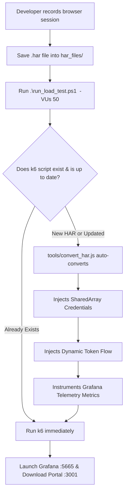

# 🚀 Universal k6 Load Testing Guide for Developers (From JMeter to k6)

This comprehensive guide is designed for developers, QA engineers, and DevOps teams who want to test production and staging web applications using **k6** without getting overwhelmed by manual scripting, complex configuration, or messy file management.

---

## 📑 Table of Contents
1. [Workspace Folder Structure](#-workspace-folder-structure)
2. [⚡ The Universal 1-Command Workflow (Zero Scripting)](#-the-universal-1-command-workflow-zero-scripting)
3. [❓ Do We Need a New Script for Every New HAR File?](#-do-we-need-a-new-script-for-every-new-har-file)
4. [🔑 How Real Account Credentials Work (1-to-1 VU Mapping)](#-how-real-account-credentials-work-1-to-1-vu-mapping)
5. [🔄 JMeter vs. k6 Concept Cheat Sheet](#-jmeter-vs-k6-concept-cheat-sheet)
6. [🪜 Step-by-Step Testing Workflow for Any Application](#-step-by-step-testing-workflow-for-any-application)
7. [📈 Scaling: From 1 User to 50,000+ Users](#-scaling-from-1-user-to-50000-users)
8. [📊 Viewing & Downloading Grafana Telemetry Reports](#-viewing--downloading-grafana-telemetry-reports)
9. [🛡️ Best Practices for Testing Production Safely](#-best-practices-for-testing-production-safely)

---

## 📁 Workspace Folder Structure

All performance testing assets are organized into dedicated drop-zones to prevent scattering files:

```
c:\Users\nithya.s\Documents\K6\
│
├── 📂 har_files/                     <-- 🎯 DROP ALL .har BROWSER RECORDINGS HERE
│   ├── README.md                     <-- How to record clean browser HAR files
│   ├── prepespro.christuniversity.in.har    <-- Old HAR (18 endpoints)
│   └── prepespro2.christuniversity.in.har   <-- New HAR (60 endpoints)
│
├── 📂 tests/
│   ├── 📂 data/                      <-- CSV parameterization files (usernames, passwords)
│   │   ├── prepespro_credentials.csv <-- Real account list (50+ accounts)
│   │   └── students.csv
│   ├── 📂 christ_university/reports/ <-- All test telemetry outputs
│   │   ├── grafana_report.html       <-- Standalone Grafana Dashboard
│   │   ├── grafana_api_metrics.csv   <-- Per-endpoint spreadsheet report
│   │   ├── grafana_summary.json      <-- Machine-readable JSON metrics
│   │   └── report_server.js          <-- Telemetry & Download Portal server
│   ├── prepespro_har_load_test.js    <-- Telemetry script for Old HAR
│   └── prepespro2_har_load_test.js   <-- Telemetry script for New HAR (60 endpoints)
│
├── 📂 tools/                         <-- Automation tools
│   └── convert_har.js                <-- On-the-fly HAR to k6 converter (handles auth + Grafana)
│
├── 📜 run_load_test.ps1              <-- ⚡ 1-Click Universal PowerShell Test Runner
├── 📘 K6_DEVELOPER_GUIDE.md          <-- Root Quick-Start Cheat Sheet
└── 📂 docs/
    └── K6_LOAD_TESTING_GUIDE_FOR_DEVELOPERS.md <-- This comprehensive guide
```

---

## ⚡ The Universal 1-Command Workflow (Zero Scripting)

You **never need to modify runner scripts or rewrite test scripts** when new HAR files arrive. The test runner [run_load_test.ps1](file:///c:/Users/nithya.s/Documents/K6/run_load_test.ps1) is completely universal.

### Syntax:
```powershell
.\run_load_test.ps1 "<har_name_or_keyword>" -VUs <number_of_users> [-Duration "<duration>"]
```

### Real Command Examples:

#### 1. Run the New HAR (`prepespro2`) with 50 Virtual Users:
```powershell
.\run_load_test.ps1 prepespro2 -VUs 50
```

#### 2. Run with Duration (e.g. 50 users continuously looping for 2 minutes):
```powershell
.\run_load_test.ps1 prepespro2 -VUs 50 -Duration "2m"
```

#### 3. Run a Future Recording (e.g. `prepespro3.har` or `hostel_booking.har`):
```powershell
# Simply drop 'prepespro3.har' into har_files/ and run:
.\run_load_test.ps1 prepespro3 -VUs 100
```
> **What happens:** The runner automatically detects the new HAR file, compiles it into a telemetry-enabled k6 test script on the fly via `tools/convert_har.js`, binds the 50 accounts, and runs the test immediately!

#### 4. Interactive Discovery (If you don't remember the file name):
```powershell
.\run_load_test.ps1 -VUs 50
```
*The runner scans [har_files/](file:///c:/Users/nithya.s/Documents/K6/har_files), lists all recordings with their size and date, highlights `[LATEST]`, and prompts you to select with one keystroke.*

---

## ❓ Do We Need a New Script for Every New HAR File?

### 💡 The Short Answer: **NO manual coding is needed!**



### Why Raw HAR Files Cannot Be Run Directly Without Conversion
1. **Single Expired Token:** A raw browser HAR file only contains the session token of the single developer who recorded it. If 50 users hit the server with that one token, they either collide or get rejected with `401 Unauthorized`.
2. **Missing Concurrency Logic:** A raw HAR has no concept of virtual user IDs (`__VU`), iteration delays, or custom threshold monitoring.
3. **Automated Solution:** Our converter automatically:
   - Replaces the hardcoded login credentials with individual user accounts from [prepespro_credentials.csv](file:///c:/Users/nithya.s/Documents/K6/tests/data/prepespro_credentials.csv).
   - Extracts the dynamic session `Bearer token` for each user.
   - Injects the fresh token into all subsequent API requests.
   - Hooks up deep Grafana telemetry counters (`api_users_triggered`, `api_hits_total`, failure diagnostics).

---

## 🔑 How Real Account Credentials Work (1-to-1 VU Mapping)

When simulating realistic traffic on an authenticated portal (like Christ University ERP), virtual users must log in as distinct individuals.

### 1. The Credentials File
Open [tests/data/prepespro_credentials.csv](file:///c:/Users/nithya.s/Documents/K6/tests/data/prepespro_credentials.csv) and paste your real accounts:
```csv
username,password
student01@christuniversity.in,Pass123!
student02@christuniversity.in,Pass456!
student03@christuniversity.in,Pass789!
...
student50@christuniversity.in,Pass50!
```

### 2. In-Memory Distribution via `SharedArray`
k6 loads this file into memory once (zero memory overhead) and distributes accounts per VU using modulo arithmetic:
```javascript
const credIndex = (__VU - 1) % credentials.length;
const userCred = credentials[credIndex];
```

| Virtual User | Credential Used | Behavior |
| :--- | :--- | :--- |
| **`VU_1`** | Account #1 from CSV | Authenticates, gets Token #1, replays entire HAR journey |
| **`VU_2`** | Account #2 from CSV | Authenticates, gets Token #2, replays entire HAR journey |
| ... | ... | ... |
| **`VU_50`** | Account #50 from CSV | Authenticates, gets Token #50, replays entire HAR journey |

---

## 🔄 JMeter vs. k6 Concept Cheat Sheet

For developers transitioning from Apache JMeter to Grafana k6:

| JMeter Concept | What it is in JMeter | k6 Equivalent | Why k6 is Better |
| :--- | :--- | :--- | :--- |
| **Test Plan (.jmx)** | XML file edited via Java GUI | Clean, readable JavaScript (`.js`) | Versionable in Git, easy pull request diffs, no GUI freeze. |
| **Thread Group** | Number of Threads & Loop Count | `export const options = { vus: 50, duration: '2m' }` | Uses lightweight OS threads; handles 10,000+ VUs with <100MB RAM. |
| **CSV Data Set Config** | Reading accounts from CSV | `new SharedArray('creds', () => ...)` | In-memory shared data structure; zero memory leaks across VUs. |
| **HTTP Sampler** | Configures URL, Method, Body | `http.get(url, params)` / `http.post(...)` | Full JavaScript flexibility; dynamic payloads and conditional flows. |
| **JSON Extractor** | Extracting tokens from login | `const token = JSON.parse(res.body).token;` | Native JavaScript parsing; no complex regex needed. |
| **Response Assertion** | Verifying status 200 | `check(res, { 'status is 200': (r) => is2xx })` | Granular pass/fail statistics automatically charted in Grafana. |
| **View Results Tree** | JMeter GUI listener (causes crashes) | Live **Grafana Web Dashboard** (`:5665`) | Real-time interactive charts, percentiles, error causes, CSV exports. |

---

## 🪜 Step-by-Step Testing Workflow for Any Application

### Step 1: Record Clean User Journey (Chrome / Edge)
1. Open Chrome/Edge and press `F12` to open **Developer Tools**.
2. Go to the **Network** tab.
3. Check **"Preserve log"** (keeps login redirects).
4. Check **"Disable cache"** (simulates realistic cold traffic).
5. (Optional) Filter by **"Fetch/XHR"** to capture only backend API endpoints.
6. Perform your workflow (e.g. Login ➔ Timetable ➔ Hostel ➔ Book Training).
7. Right-click any network request ➔ **"Save all as HAR with content"** (or click `↓`).
8. Save into the drop-zone:
   ```
   har_files/<your_workflow_name>.har
   ```

### Step 2: Trigger the Universal Test Runner
Run a single command in PowerShell:
```powershell
.\run_load_test.ps1 <your_workflow_name> -VUs 50
```
- If the test script does not exist, it is generated automatically.
- Each virtual user authenticates with its own account.
- All recorded API endpoints are replayed with proper timing and telemetry.

### Step 3: Inspect Telemetry & Download Reports
When the test completes, two browser tabs open automatically:
1. **Live Grafana Dashboard** ([http://127.0.0.1:5665](http://127.0.0.1:5665)):
   - Response time distributions & percentiles (`p90`, `p95`, `p99`).
   - Active users and requests per second.
   - API failure breakdown with exact HTTP error status codes.
2. **Download Portal** ([http://localhost:3001](http://localhost:3001)):
   - **Download CSV**: Per-endpoint spreadsheet with user counts, hit counts, failure rates, and latencies.
   - **Download HTML / JSON**: Offline artifacts for QA reports and CI/CD pipelines.

---

## 📈 Scaling: From 1 User to 50,000+ Users

### Concurrency Levels & Execution Modes:

```powershell
# Level 1: Smoke Test (1 User, 1 Iteration) - Verify endpoints respond 200 OK
.\run_load_test.ps1 prepespro2 -VUs 1

# Level 2: Concurrency Test (50 Users, 1 Iteration per user)
.\run_load_test.ps1 prepespro2 -VUs 50

# Level 3: Duration / Stress Test (50 Users looping continuously for 5 minutes)
.\run_load_test.ps1 prepespro2 -VUs 50 -Duration "5m"
```

### What Happens If You Have 50 Accounts But Need 50,000 VUs?
- **Concurrent Virtual Users vs. Real Accounts:** 50,000 VUs means 50,000 parallel network connections.
- If you run 50,000 VUs with 50 accounts, multiple virtual users will share each account. Some enterprise applications terminate concurrent logins for the same user ID (`Single-Session Enforcement`).
- **Best Practice for Extreme Scale (50,000+ VUs):**
  1. Generate or provision 5,000 to 10,000 test credentials in [prepespro_credentials.csv](file:///c:/Users/nithya.s/Documents/K6/tests/data/prepespro_credentials.csv).
  2. Use distributed load generators (k6 Operator on Kubernetes or multiple worker machines).

---

## 📊 Viewing & Downloading Grafana Telemetry Reports

| Feature | URL | Description |
| :--- | :--- | :--- |
| **Live Grafana Dashboard** | [http://127.0.0.1:5665](http://127.0.0.1:5665) | Real-time interactive charts, response time trends, error breakdowns, and check assertions. |
| **Telemetry Download Portal** | [http://localhost:3001](http://localhost:3001) | 1-Click download buttons for CSV, HTML, and JSON reports. |
| **Direct CSV Export** | [http://localhost:3001/download/csv](http://localhost:3001/download/csv) | Instant spreadsheet download for Excel / Google Sheets reporting. |

---

## 🛡️ Best Practices for Testing Production Safely

1. **Always run a 1-VU smoke test first:** Before triggering 50 or 500 users, run `.\run_load_test.ps1 <name> -VUs 1` to ensure credentials and endpoints are valid.
2. **Be cautious with Write/Delete requests:** `GET` endpoints are safe. `POST` or `DELETE` endpoints that save records or book resources will actually commit changes to the database! Use dedicated test accounts or test records.
3. **Use granular timeouts:** All generated requests include `timeout: '15s'` so slow or hanging backend servers do not block the test runner indefinitely.
