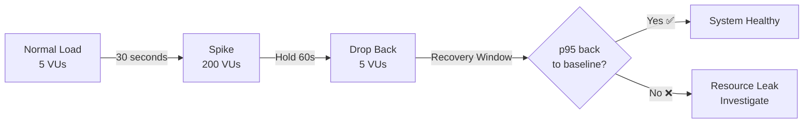
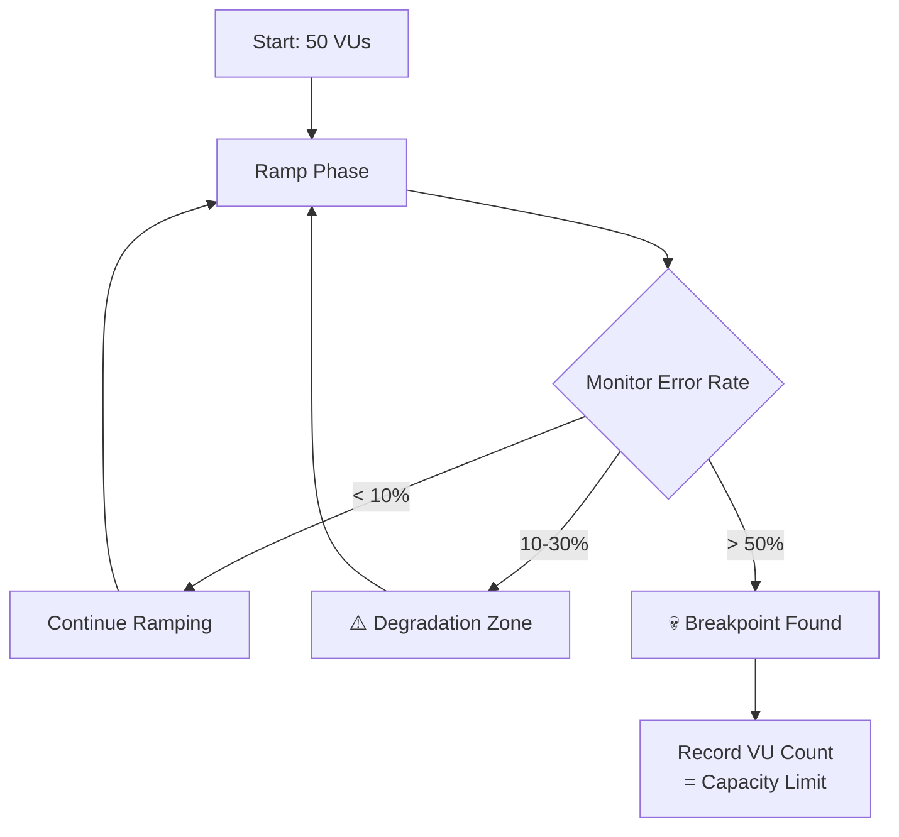
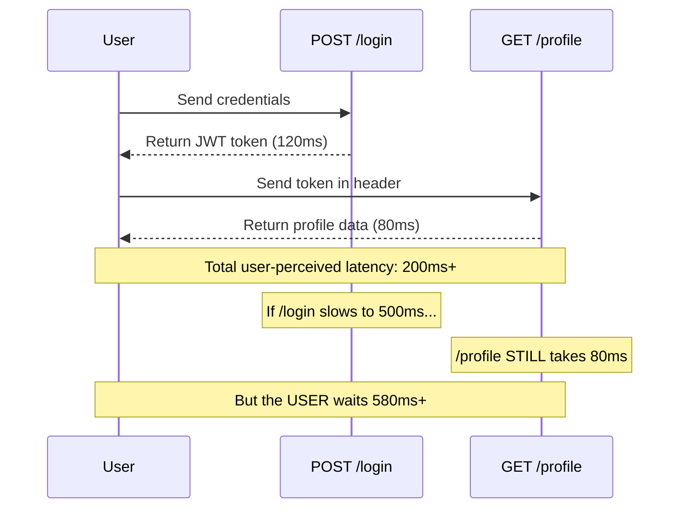

# 4 Load Test Profiles Every PM Should Demand Before Launch

## Introduction

Most engineering teams ship features without ever running a performance test. The assumption is simple: "It works in staging, it'll work in production." Then launch day arrives, traffic spikes, and the team is firefighting 500 errors while customers churn. The post-mortem always says the same thing — *"We should have load tested."* The reality is that performance failures are predictable and preventable, but only if you test before you ship.

Performance testing isn't just an engineering task — it's a **product quality decision**. A PM who waits for engineering to "get around to it" is accepting unknown risk on behalf of every user. The question isn't whether your API can handle 10 requests. The question is: what happens at 200? At 600? At 3 AM on a Sunday when nobody's watching? These are product questions, not infrastructure questions. And they deserve product-level attention.

This guide covers **4 load test profiles** we ran against a real Node.js/Express API, with actual metrics from each run. Each profile answers a specific PM question, surfaces a specific risk, and ties directly to a business outcome. If you're a PM reading this, these are the 4 tests you should demand from your engineering team before every major launch.

---

## Profile 1: Baseline — Your SLA Reference Point

### What It Is

A baseline test simulates your **normal expected traffic** — the load your system handles on a typical day. We ran 20 virtual users (VUs) over a 4.5-minute window with gentle ramp-up and ramp-down phases.

### The PM Question It Answers

> *"What does healthy look like?"*

Without a baseline, you have no reference point. You can't define "degradation" if you haven't defined "normal." Most teams skip this test entirely, and then spend hours in incident calls arguing about whether 500ms is slow or acceptable.

### Key Metrics & Thresholds

| Metric | Target | Why |
|--------|--------|-----|
| p(95) response time | < 300ms | 95% of users should get a snappy experience |
| Error rate | < 1% | Near-zero failures under normal conditions |
| Checks pass rate | 100% | Every response matches expected schema and status |

### The Real Insight

> Without a baseline, you can't define degradation. Most teams skip this and then argue about whether 500ms is slow or not. Your baseline is your SLA's foundation — every other test profile is measured against it.

### Business Impact

- **SLA violations**: If you can't prove your baseline meets your SLA, you can't promise anything to customers
- **Customer churn**: Consistent slow responses erode trust — users don't complain, they just leave
- **Engineering prioritization**: A documented baseline gives PMs ammunition to prioritize performance work over feature work when metrics drift

---

## Profile 2: Spike — Can You Survive a Viral Moment?

### What It Is

A spike test simulates a **sudden, dramatic surge** in traffic. We ramped from 5 VUs to 200 VUs in under 30 seconds, held the spike briefly, then dropped back to baseline. This mimics a Product Hunt feature, a viral tweet, or a flash sale notification hitting thousands of phones at once.

### The PM Question It Answers

> *"What happens if we get featured on Product Hunt?"*

### Key Metrics & Thresholds

| Metric | Target | Why |
|--------|--------|-----|
| p(95) response time | < 2000ms | Relaxed threshold — some slowdown is expected during a spike |
| Error rate | < 5% | A small number of errors is acceptable; a cascade is not |
| Recovery time | Return to baseline p95 within 60s | The system must self-heal after the spike |

### The Real Insight

> The spike isn't the test. **The recovery IS.** If p95 doesn't return to baseline after the spike drops, you have resource leaks — unclosed connections, exhausted thread pools, or memory that never gets freed. A system that survives the spike but stays degraded afterward is arguably worse than one that fails fast.

### Business Impact

- **Revenue loss during flash sales**: If your checkout API can't handle the spike, you're literally burning money
- **Viral moments are unpredictable**: You can't schedule when a TikTok goes viral — your system needs to handle it automatically
- **Reputation damage**: A public outage during a high-visibility moment becomes the story instead of your product



---

## Profile 3: Breakpoint — Where Does Your System Die?

### What It Is

A breakpoint test is a **relentless, ever-increasing ramp** designed to push your system past its limits. We started at 50 VUs and ramped continuously to 600 VUs over 10 minutes. The goal isn't to pass — it's to find the exact point where things break.

### The PM Question It Answers

> *"How many concurrent users can we actually handle?"*

### Key Metrics & Thresholds

| Metric | Target | Why |
|--------|--------|-----|
| Error rate threshold | 50% | Intentionally loose — we're looking for the *point* of failure, not preventing it |
| p(95) response time | Monitored, not gated | We want to observe degradation, not stop the test early |
| VU count at failure | The actual deliverable | This number becomes your capacity ceiling |

### The Real Insight

> Node.js single-threaded architecture buckled around **400 concurrent connections**. This is your hard capacity limit. Autoscaling MUST trigger before this number. If your infrastructure can't spin up new instances before you hit 400 VUs, you're one traffic spike away from a total outage.

### Business Impact

- **Capacity planning**: This number directly informs how many instances you need, and therefore your infrastructure budget
- **Autoscaling configuration**: Your autoscaling trigger should fire at ~60% of this limit (around 240 VUs in our case)
- **Launch readiness**: If your projected launch traffic exceeds this number, you are not ready to launch — full stop



---

## Profile 4: Soak — The Silent Killer

### What It Is

A soak test runs **moderate, steady load for an extended period** — typically 30 minutes or longer. We held 20 VUs constant for 30 minutes. The load isn't the challenge; the duration is. Soak tests reveal problems that short tests can never catch.

### The PM Question It Answers

> *"Will this app still work at 3 AM?"*

### Key Metrics & Thresholds

| Metric | Target | Why |
|--------|--------|-----|
| p(95) response time | Must stay **FLAT** across 30 min | Any upward drift signals a leak or resource exhaustion |
| Error rate | < 1% sustained | Errors that appear after 20 minutes indicate time-dependent bugs |
| Memory trend | No monotonic increase | Rising memory = leak that will eventually crash the process |

### The Real Insight

> Memory leaks don't show up in 60-second tests. Our Express server had a potential leak vector in the **in-memory token store** — tokens were being created on every login but never expired. Over a 30-minute soak, this store would grow unbounded. We added **60-second auto-expiry** as a safeguard. Without the soak test, this would have surfaced as a 3 AM OOM crash in production.

### Business Impact

- **Overnight crashes**: The worst kind of outage — nobody notices until customers report it the next morning
- **Data corruption**: A server running out of memory doesn't shut down gracefully — in-flight requests get dropped, writes get corrupted
- **Customer trust**: B2B customers run integrations 24/7. If your API dies at night, their pipelines fail, and they start evaluating alternatives

---

## The CI/CD Gate — Automating the Decision

Performance testing is only useful if it's **automated and enforced**. A test that lives in a wiki and gets run "when someone remembers" is security theater.

### How We Integrated k6 Into GitHub Actions

We created a dedicated CI pipeline (`performance.yml`) that runs on every push to `main`:

1. **Start the Express server** in the background
2. **Run `08_ci_pipeline.js`** — a strict baseline test with custom metrics
3. **Evaluate thresholds** — k6 automatically exits with code 99 if any threshold fails
4. **Block the merge** — GitHub Actions treats exit code 99 as a failure, preventing the PR from merging

### Custom Metrics We Track

| Metric | Type | Purpose |
|--------|------|---------|
| `login_duration` | Trend | Isolate auth endpoint performance |
| `profile_duration` | Trend | Isolate protected endpoint performance |
| `auth_flow_success` | Rate | End-to-end success rate of login → profile chain |

### Exit Code Behavior

```
Exit Code 0  → All thresholds passed → ✅ Deploy
Exit Code 99 → Threshold violated    → ❌ Deployment blocked
Exit Code 1  → Script error          → ❌ Pipeline failed
```

### The PM Takeaway

> Performance is not a post-launch concern. It's a **merge gate**. If you wouldn't ship a feature without unit tests passing, why would you ship it without performance tests passing?

---

## Metrics That Matter — Quick Reference

| Metric | What It Tells You | PM Decision It Informs | Red Flag Threshold |
|--------|-------------------|------------------------|--------------------|
| `http_req_duration` (p95) | 95th percentile response time — what most users experience | SLA definition, UX quality sign-off | > 300ms under normal load |
| `http_req_duration` (p99) | Tail latency — what your worst-experience users see | Whether to invest in tail-latency optimization | > 500ms under normal load |
| `http_req_failed` | Percentage of requests that returned errors | Go/no-go launch decision | > 1% under normal load |
| `checks` (pass rate) | Whether responses match expected structure and values | API contract compliance | < 100% (any check failure) |
| `iterations` | How many complete VU loops executed | Test validity and throughput capacity | Unusually low = bottleneck |
| `vus_max` | Peak concurrent virtual users during the test | Infrastructure scaling decisions | Exceeding known breakpoint |

---

## The Correlation Problem — Why Isolated Endpoint Tests Lie

### The False Confidence Trap

Testing `/health` in isolation gives you a green dashboard and false confidence. A health endpoint returns a static JSON object in under 5ms — it tells you the server is running, not that it's performing well. Teams that only test health endpoints discover the hard way that their actual user flows are 10x slower.

### Why User Journeys Matter

In a real application, requests are **chained**. A user doesn't call `/profile` in isolation — they call `/login` first, extract a token, then call `/profile` with that token. This is correlation, and it's where performance testing gets real:



If `/login` slows down due to bcrypt load or database contention, **every downstream request is delayed** — even if those endpoints are individually fast. The chain is only as fast as its slowest link.

### The PM Insight

> Always test the **user journey**, not the endpoint. A green health check means nothing if your login flow takes 2 seconds. Performance testing must mirror how real users interact with your product — sequential, dependent, and unforgiving.

---

## Tech Stack

| Component | Technology |
|-----------|------------|
| Load Testing | [k6](https://k6.io/) by Grafana Labs |
| Target API | Node.js + Express |
| CI/CD | GitHub Actions with k6 threshold gating |
| Visualization | Grafana + InfluxDB (optional) |
