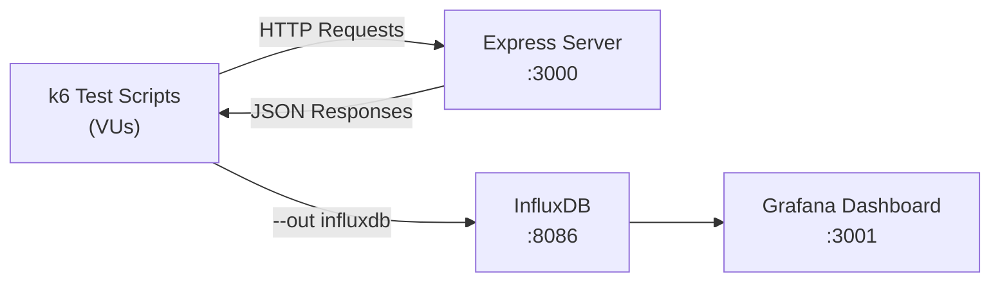

# k6 Load Testing — Complete Architecture & Step-by-Step Plan

## 🏗️ Project Architecture

This is a **hands-on k6 load testing learning project** with two main components:

### Component 1: Target Express Server
**File**: [index.js](file:///Users/rahulr/Documents/k6_learning/files/index.js)

A simple Node.js/Express API that acts as the **system under test (SUT)**. It has:

| Route | Method | Purpose |
|-------|--------|---------|
| `/health` | GET | Health check — returns `{ status: "ok", timestamp, uptime }` |
| `/login` | POST | Authenticates a user → returns a fake JWT-like token (base64-encoded) |
| `/profile` | GET | Protected route — requires `Authorization: Bearer <token>` header |

- **10 hardcoded users** (alice, bob, carol, etc.) stored in-memory
- **Token store** is an in-memory `Map()` — tokens auto-expire after 60 seconds
- Runs on **port 3000**

---

### Component 2: Progressive k6 Test Scripts (8 tasks, 10 files)

Each script teaches a specific k6 concept, building on the previous one:

| # | File | Concept | What You Learn |
|---|------|---------|----------------|
| 1 | [01_hello_world.js](file:///Users/rahulr/Documents/k6_learning/files/01_hello_world.js) | VUs, iterations, summary | What a basic k6 test looks like — 5 VUs hitting `/health` for 10s |
| 2 | [02_stages.js](file:///Users/rahulr/Documents/k6_learning/files/02_stages.js) | Ramping load profiles | Ramp-up → hold → ramp-down (0 → 50 → 50 → 0 VUs) |
| 3 | [03_thresholds.js](file:///Users/rahulr/Documents/k6_learning/files/03_thresholds.js) | Pass/fail gating (CI/CD) | SLA rules: p95 < 500ms, error rate < 1% — exit code 99 on failure |
| 4 | [04_checks.js](file:///Users/rahulr/Documents/k6_learning/files/04_checks.js) | Response validation | Inline assertions on status, body, and response time |
| 5 | [05_auth_flow.js](file:///Users/rahulr/Documents/k6_learning/files/05_auth_flow.js) | ★ Correlation / chaining | Login → extract token → use token on `/profile` (most important!) |
| 6 | [06_parameterize.js](file:///Users/rahulr/Documents/k6_learning/files/06_parameterize.js) | SharedArray, CSV data | Load users from CSV, distribute across VUs using `__VU` and `__ITER` |
| 7a | [07a_baseline.js](file:///Users/rahulr/Documents/k6_learning/files/07a_baseline.js) | Baseline profile | Normal load (20 VUs, 4.5 min) — establishes SLA reference |
| 7b | [07b_spike.js](file:///Users/rahulr/Documents/k6_learning/files/07b_spike.js) | Spike profile | Sudden surge: 5 → 200 VUs — tests recovery behavior |
| 7c | [07c_breakpoint.js](file:///Users/rahulr/Documents/k6_learning/files/07c_breakpoint.js) | Breakpoint / stress | Ramp 50 → 100 → 200 → 400 → 600 VUs — find where Node.js breaks |
| 7d | [07d_soak.js](file:///Users/rahulr/Documents/k6_learning/files/07d_soak.js) | Soak / endurance | 20 VUs for 30+ minutes — detects memory leaks and drift |

### Component 3: Grafana + InfluxDB Dashboard (Optional)
**File**: [docker-compose.yml](file:///Users/rahulr/Documents/k6_learning/files/docker-compose.yml)

- **InfluxDB 1.8** on port 8086 — stores k6 metric time-series
- **Grafana 10.2** on port 3001 — visualizes metrics with official k6 dashboard (ID 2587)

---

## 🔄 Data Flow

---

## 📋 Step-by-Step Execution Plan

> [!IMPORTANT]
> The README tells you to install Claude Desktop and connect MCP there. **Ignore that entirely.** We'll do everything right here in Antigravity — no Claude Desktop needed.

### Phase 1: Setup & Prerequisites
- [ ] **Step 1** — Check if Node.js and k6 are installed (`node -v`, `k6 version`)
- [ ] **Step 2** — Reorganize the project structure (files are all flat in `/files`, they need a proper `server/` and `tests/` layout)
- [ ] **Step 3** — Install Express dependency (`npm install express`)
- [ ] **Step 4** — Start the target Express server (`node index.js`)
- [ ] **Step 5** — Verify the server is running (`curl localhost:3000/health`)

### Phase 2: Run Tests Progressively (Learn k6)
- [ ] **Step 6** — Run Task 1: Hello World — understand VUs, iterations, summary output
- [ ] **Step 7** — Run Task 2: Stages — understand load ramping profiles
- [ ] **Step 8** — Run Task 3: Thresholds — understand pass/fail gating for CI/CD
- [ ] **Step 9** — Run Task 4: Checks — understand response validation
- [ ] **Step 10** — Run Task 5: Auth Flow — ★ the most important one (correlation/chaining)
- [ ] **Step 11** — Run Task 6: Parameterize — need to create `data/users.csv` first
- [ ] **Step 12** — Run Task 7a–7d: Load profiles (baseline, spike, breakpoint, soak)

### Phase 3: Connect MCP to Antigravity (NOT Claude Desktop)

> [!CAUTION]
> The README says to configure `claude_desktop_config.json` for Claude Desktop. **We skip that.** Instead, we'll connect the MCP filesystem server to **Antigravity** so it can read/write your test files directly.

- [ ] **Step 13** — Set up the `@modelcontextprotocol/server-filesystem` MCP server pointing at this project
- [ ] **Step 14** — Test that the MCP tools work (read files, list directory, etc.)
- [ ] **Step 15** — Use Antigravity + MCP to interactively improve tests, add custom metrics, and auto-generate new scripts

### Phase 4: Optional — Grafana Dashboard
- [ ] **Step 16** — `docker compose up -d` (requires Docker Desktop)
- [ ] **Step 17** — Run a test with `--out influxdb=http://localhost:8086/k6`
- [ ] **Step 18** — Import dashboard ID 2587 in Grafana at `http://localhost:3001`

---

## ⚠️ Issues I Noticed

1. **Flat file structure** — All files are dumped in `/files/`. The test scripts reference paths like `tests/01_hello_world.js` and `server/index.js`, but there's no `tests/` or `server/` directory. We need to reorganize.
2. **Missing `package.json`** — No npm init has been done, so `npm install express` won't work properly yet.
3. **Missing `data/users.csv`** — Task 6 (`06_parameterize.js`) expects a `./data/users.csv` file that doesn't exist.
4. **MCP section is Claude-biased** — The README tells you to install Claude Desktop. We'll ignore that and connect MCP to Antigravity instead.

---

## 🚀 Ready to Start?

Tell me when you want to begin, and we'll start with **Phase 1: Setup & Prerequisites** — I'll check your tools, reorganize the project, and get the server running.
