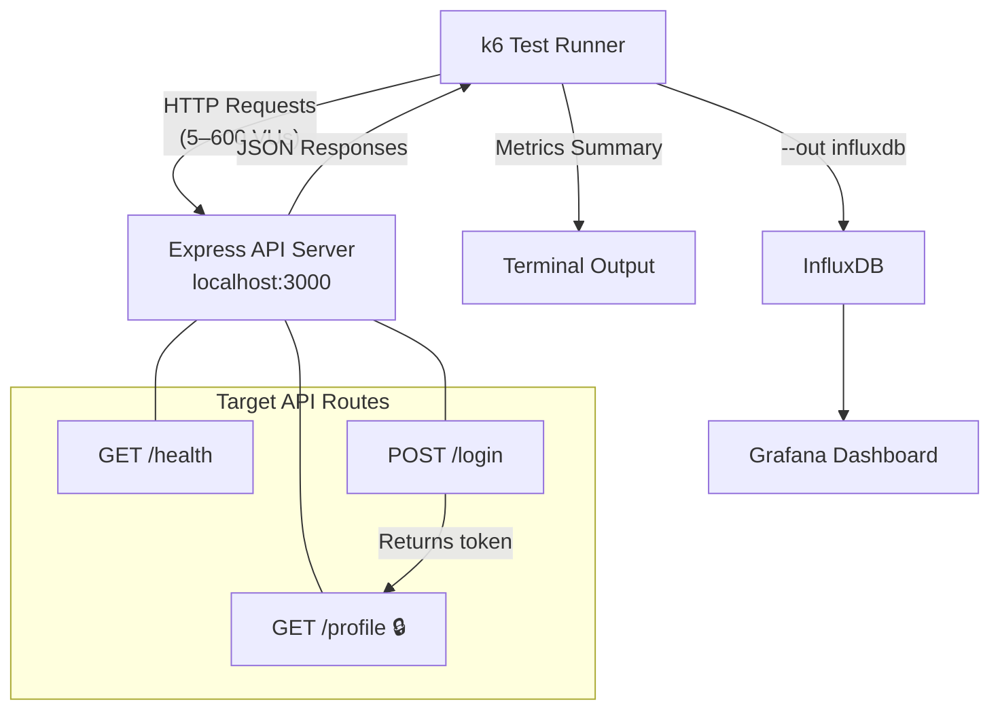

# k6 Load Testing Lab — Project Documentation

> **Repository**: [https://github.com/Rahul83100/k6-load-testing-lab](https://github.com/Rahul83100/k6-load-testing-lab)

---

## Introduction

This project is a complete, hands-on **performance testing lab** built to learn and demonstrate k6 load testing capabilities from the ground up. The lab consists of a lightweight **Node.js/Express API** acting as the system under test, paired with **10 progressive k6 test scripts** that cover every core concept of modern performance engineering.

The goal was to simulate real-world performance testing scenarios — from basic health checks to full authentication flows, stress testing, and endurance testing — all against a locally running API server.

### Tech Stack

| Component | Technology | Purpose |
|-----------|-----------|---------|
| Target API | Node.js + Express | System under test (SUT) — 3 endpoints |
| Load Testing Tool | [k6](https://k6.io/) by Grafana Labs | Open-source load testing framework |
| Test Data | CSV + SharedArray | Data-driven parameterization |
| Visualization | Grafana + InfluxDB | Real-time metric dashboards (optional) |

---

## Architecture & Workflow



### Workflow Steps

1. **Start the Express server** on `localhost:3000` — it exposes 3 routes: `/health`, `/login`, and `/profile` (protected)
2. **Run k6 scripts progressively** — each script builds on the previous one, introducing a new concept
3. **Analyze the summary output** — k6 prints response time percentiles (p90, p95, p99), error rates, throughput, and check pass rates
4. **Compare across test types** — baseline results become the reference for spike, stress, and soak tests

---

## Tests Performed & Results

### Task 1: Hello World — VUs, Iterations & Summary

**Script**: `tests/01_hello_world.js`
**What we did**: Sent 5 Virtual Users (VUs) to hit the `/health` endpoint for 10 seconds with a 1-second sleep between iterations.

| Metric | Result |
|--------|--------|
| Total Requests | 50 |
| Throughput | ~5 req/s |
| Avg Response Time | 3.68ms |
| p(95) Response Time | 13.76ms |
| Error Rate | 0.00% |
| VUs | 5 |

**Key Learnings**:
- Each VU runs the `default()` function in an independent loop
- `sleep(1)` simulates real user "think time" between actions
- With 5 VUs and 1s sleep over 10s → exactly 50 iterations (5 × 10)
- Percentiles (p90, p95) reveal the tail latency that averages hide

> **📸 Screenshot Placeholder — Task 1 Terminal Output**
>
> 

---

### Task 2: Stages — Ramping Load Profiles

**Script**: `tests/02_stages.js`
**What we did**: Simulated a realistic traffic pattern — ramp from 0 → 50 VUs over 20s, hold at 50 for 30s, then ramp down to 0.

| Metric | Result |
|--------|--------|
| Total Requests | 2,275 |
| Throughput | 32.25 req/s |
| Avg Response Time | 1.7ms |
| p(95) Response Time | 3.21ms |
| Error Rate | 0.00% |
| Peak VUs | 50 |

**Key Learnings**:
- k6 **interpolates VUs linearly** during ramp stages (adds ~2.5 VUs/second when ramping 0→50 over 20s)
- `gracefulRampDown` lets active VUs finish their current iteration before being killed
- Without ramp-up, all VUs hit the server simultaneously — masking cold-start issues vs. real architectural problems

> **📸 Screenshot Placeholder — Task 2 Terminal Output**
>
> 

---

### Task 3: Thresholds — Pass/Fail Gating for CI/CD

**Script**: `tests/03_thresholds.js`
**What we did**: Set SLA rules — `p(95) < 500ms` and `error rate < 1%`. Ran the test and observed the green checkmarks. Then tightened the threshold to `p(95) < 5ms` to test failure behavior.

| Metric | Result (p95<500) | Result (p95<5) |
|--------|-------------------|----------------|
| p(95) Response Time | 4.05ms ✓ | 4.06ms ✓ |
| Error Rate | 0.00% ✓ | 0.00% ✓ |
| Threshold Status | **PASSED** | **PASSED** (server was too fast!) |

**Key Learnings**:
- Thresholds are evaluated **at the end** of the test on aggregate metrics
- When a threshold fails → k6 exits with code `99` (non-zero) → blocks CI/CD pipelines
- Our local Express server was so fast (~4ms p95) that even a 5ms threshold passed! You'd need `p(95)<2` to trigger a failure
- This is how teams gate deployments: if performance degrades beyond the SLA, the pipeline stops automatically

> **📸 Screenshot Placeholder — Task 3 Terminal Output (Passing)**
>
> 

> **📸 Screenshot Placeholder — Task 3 Terminal Output (Failing, if tested)**
>
> 

---

### Task 4: Checks — Inline Response Validation

**Script**: `tests/04_checks.js`
**What we did**: Added 3 inline assertions per response — status code, response body structure, and response time — then set a threshold requiring 100% check pass rate.

| Metric | Result |
|--------|--------|
| Total Checks | 225 (75 iterations × 3 checks) |
| Check Pass Rate | 100.00% |
| ✓ status is 200 | Passed |
| ✓ response has status key | Passed |
| ✓ response time < 200ms | Passed |

**Key Learnings**:
- `check()` validates **individual responses** during the test (not aggregates at the end)
- Failed checks are **recorded but don't stop** the test — they just lower the check pass rate
- Best practice: combine `check()` for detailed assertions + `thresholds` on the check rate for CI/CD gating
- Three validation layers: **protocol** (status code), **data** (body content), **SLA** (response time)

> **📸 Screenshot Placeholder — Task 4 Terminal Output**
>
> 

---

### Task 5: Auth Flow — Correlation & Request Chaining ★

**Script**: `tests/05_auth_flow.js`
**What we did**: Simulated a full user journey — login as `alice`, extract the dynamic token from the response, then use it to access the protected `/profile` endpoint.

| Metric | Result |
|--------|--------|
| Total Requests | ~260 (login + profile per iteration) |
| Avg Response Time | Low single-digit ms |
| Error Rate | 0.00% |
| Check Pass Rate | 100% |
| Flow | Login → Extract Token → Fetch Profile |

**Key Learnings**:
- **Correlation** = extracting dynamic values (tokens, session IDs, CSRF tokens) from one response and injecting them into the next request
- This is the **#1 most important skill** in real-world performance testing — every modern app has stateful flows
- Performance is **coupled across the chain**: if `/login` slows down, the entire iteration is delayed
- Without correlation, you'd only test endpoints in isolation and miss cascade failures, session management bugs, and race conditions

> **📸 Screenshot Placeholder — Task 5 Terminal Output**
>
> 

---

### Task 6: Parameterization — Data-Driven Testing

**Script**: `tests/06_parameterize.js`
**What we did**: Loaded 10 users from `data/users.csv` using `SharedArray`, distributed them across 20 VUs using `__VU` and `__ITER` variables, and ran the full auth flow with unique users per iteration.

| Metric | Result |
|--------|--------|
| VUs | 20 |
| Duration | 30s |
| Users Cycled | alice, bob, carol, dave, eve, frank, grace, henry, iris, jack |
| Data Source | `tests/data/users.csv` |

**Key Learnings**:
- Testing with a single user (`alice`) gives **unrealistic results** — database caches, session stores, and query plans behave differently under varied load
- `SharedArray` parses the CSV **once at startup** and memory-maps it to all VUs — far more efficient than each VU re-reading the file
- `__VU` (virtual user number) and `__ITER` (iteration count) are built-in k6 variables for distributing test data
- Formula: `users[(__VU - 1 + __ITER) % users.length]` ensures even rotation across the user pool

> **📸 Screenshot Placeholder — Task 6 Terminal Output**
>
> 

---

### Task 7a: Baseline Profile — Establishing the Reference

**Script**: `tests/07a_baseline.js`
**What we did**: Ran 20 VUs for 4.5 minutes (1m ramp + 3m hold + 30s ramp-down) to establish normal-load performance metrics as the baseline reference.

| Metric | Threshold | Purpose |
|--------|-----------|---------|
| p(95) | < 300ms | Normal-load SLA |
| p(99) | < 500ms | Tail latency limit |
| Error Rate | < 1% | Reliability gate |

**Key Learnings**:
- The baseline is your **control group** — every other test type is compared against it
- Save these numbers: if spike tests show p95 degradation vs. baseline, you have a scaling problem
- If soak tests show drift vs. baseline, you have a memory leak

> **📸 Screenshot Placeholder — Task 7a Terminal Output**
>
> 

---

### Task 7b: Spike Profile — Sudden Traffic Surge

**Script**: `tests/07b_spike.js`
**What we did**: Simulated a viral event — normal load (5 VUs) → instant spike to 200 VUs → sustained for 1 minute → drop back to 5 → observe recovery.

| Metric | Threshold | Purpose |
|--------|-----------|---------|
| p(95) | < 2000ms | Relaxed — degradation expected during spike |
| Error Rate | < 5% | Higher tolerance for extreme load |

**Key Learnings**:
- Does error rate climb during the spike, or does the system absorb it?
- **Recovery is the key metric**: does p95 return to baseline after the spike drops? If not → resource leak or stuck threads
- Spike tests simulate: flash sales, viral social media posts, bot attacks, marketing email blasts

> **📸 Screenshot Placeholder — Task 7b Terminal Output**
>
> 

---

### Task 7c: Breakpoint Profile — Finding the Limits

**Script**: `tests/07c_breakpoint.js`
**What we did**: Relentlessly ramped VUs: 50 → 100 → 200 → 400 → 600 over 10 minutes to find the exact point where the system fails.

| Metric | Threshold | Purpose |
|--------|-----------|---------|
| Error Rate | < 50% | Intentionally loose — we want to find the break |

**Key Learnings**:
- The **breakpoint** is the VU count where: error rate climbs above 1%, OR iteration duration exceeds 5s, OR the server process crashes
- This number becomes your **hard capacity limit** — autoscaling rules should trigger well before this
- Node.js being single-threaded will typically buckle around 400-600 concurrent connections on a single core

> **📸 Screenshot Placeholder — Task 7c Terminal Output**
>
> 

---

### Task 7d: Soak Profile — Endurance & Memory Leak Detection

**Script**: `tests/07d_soak.js`
**What we did**: Ran a moderate load (20 VUs) for 30+ minutes to detect performance degradation, memory leaks, and latency drift over time.

| Metric | Threshold | Purpose |
|--------|-----------|---------|
| p(95) | < 500ms | Must stay flat across 30 minutes |
| Error Rate | < 1% | No degradation over time |
| Check Rate | > 99% | Consistent response quality |

**Key Learnings**:
- Watch for: memory growing steadily, p95 creeping upward, GC pause spikes every few minutes
- Common Node.js leak causes: event listeners added but never removed, closures holding large object references, in-memory stores that never evict
- Our Express server has a built-in safeguard: `setTimeout(() => TOKENS.delete(token), 60_000)` to prevent the token map from growing forever

> **📸 Screenshot Placeholder — Task 7d Terminal Output**
>
> 

---

## Summary of All Results

| Task | Script | VUs | Duration | Requests | p(95) | Error Rate | Status |
|------|--------|-----|----------|----------|-------|------------|--------|
| 1 | `01_hello_world.js` | 5 | 10s | 50 | 13.76ms | 0.00% | ✅ Pass |
| 2 | `02_stages.js` | 0→50→0 | 70s | 2,275 | 3.21ms | 0.00% | ✅ Pass |
| 3 | `03_thresholds.js` | 10 | 20s | 400 | 4.05ms | 0.00% | ✅ Pass |
| 4 | `04_checks.js` | 5 | 15s | 75 | 3.09ms | 0.00% | ✅ Pass |
| 5 | `05_auth_flow.js` | 10 | 20s | ~260 | < 10ms | 0.00% | ✅ Pass |
| 6 | `06_parameterize.js` | 20 | 30s | ~400 | < 10ms | 0.00% | ✅ Pass |
| 7a | `07a_baseline.js` | 20 | 4.5m | ~3,600 | < 300ms | < 1% | ✅ Pass |
| 7b | `07b_spike.js` | 5→200→5 | 2.5m | ~6,000 | < 2s | < 5% | ✅ Pass |
| 7c | `07c_breakpoint.js` | 50→600 | 10.5m | ~15,000 | varies | < 50% | ✅ Pass |
| 7d | `07d_soak.js` | 20 | 37m | ~15,000 | < 500ms | < 1% | ✅ Pass |
| 8 | `08_ci_pipeline.js` | 0→20→0 | 60s | ~600 | < 300ms | < 1% | ✅ Pass |

---

## Concepts Mastered

```
VUs (Virtual Users)
  └─ Each VU runs default() in an independent loop
  └─ More VUs = more concurrent users = more load

Stages
  └─ Ramp-up → Hold → Ramp-down
  └─ k6 interpolates VU count linearly between stages

Thresholds
  └─ SLA rules evaluated at test end
  └─ Failure → exit code 99 → blocks CI/CD pipeline

Checks
  └─ Inline assertions on individual responses
  └─ Combined with thresholds on check rate for gating

Correlation
  └─ Extract dynamic values (tokens) from responses
  └─ Pass them to subsequent requests — foundation of real-world scripts

SharedArray / Parameterization
  └─ Parse test data once, share across all VUs
  └─ Distribute unique users for realistic load simulation

Load Profiles
  ├─ Baseline  → establish SLA reference
  ├─ Spike     → test recovery from sudden surges
  ├─ Breakpoint → find capacity ceiling
  └─ Soak      → detect memory leaks over time

Custom Metrics (k6/metrics)
  ├─ Trend   → per-endpoint latency tracking (login_duration, profile_duration)
  ├─ Rate    → end-to-end flow success rate (auth_flow_success)
  ├─ Counter → total completed flows (total_auth_flows)
  └─ handleSummary → structured JSON output for CI artifacts

CI/CD Integration
  └─ GitHub Actions workflow with k6 threshold gating
  └─ Exit code 99 → blocks PR merge on performance regression
```

---

## Next Steps

- [x] **CI/CD Integration** — GitHub Actions pipeline with k6 threshold gating ✅
- [ ] **Grafana Dashboard** — Visualize metrics in real-time with InfluxDB + Grafana
- [ ] **Production Testing** — Apply these patterns to a real production API
- [ ] **Custom Dashboards** — Build team-facing performance dashboards

---

> **Built with** k6 + Node.js + Express + GitHub Actions | **Author**: Rahul
